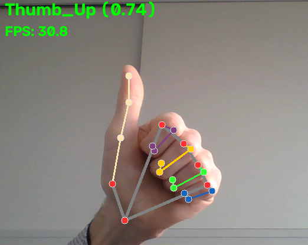

<!--
theme: fhtw
title: 'Assistive Technologies Platformen - Hand Gesture Recognition'
footer: 'Assistive Technologies Platformen - Hand Gesture Recognition'
paginate: true
_paginate: skip
_footer: ''
_class: lead
-->

# Assistive Technologies Platformen
## Hand Gesture Recognition

---

# Example result

<!-- Add your hand-tracking screenshot here. -->

The finished webcam window shows detected hand landmarks and connections, the predicted gesture with its score, and the FPS overlay.



---

## What we are building

For every frame from the webcam, the program will:

1. Read a frame with OpenCV.
2. Convert the frame from OpenCV's BGR channel order to RGB.
3. Ask MediaPipe's Gesture Recognizer to process the frame.
4. Draw hand landmarks, their connections, the gesture name, and its score.
5. Show the result and an estimated frame rate.

The recognizer runs in **video mode**, so each frame also needs a timestamp that increases over time. See the [MediaPipe Gesture Recognizer Python guide](https://ai.google.dev/edge/mediapipe/solutions/vision/gesture_recognizer/python) for the task workflow and model options.

---

## API references

Use the official API documentation when you need the full list of parameters, return values, and supported properties:

| Library | Relevant API descriptions |
|---|---|
| OpenCV | [Video I/O (`VideoCapture`)](https://docs.opencv.org/4.x/d8/dfe/classcv_1_1VideoCapture.html), [color conversion (`cvtColor`)](https://docs.opencv.org/4.x/d8/d01/group__imgproc__color__conversions.html), [drawing (`putText`)](https://docs.opencv.org/4.x/d6/d6e/group__imgproc__draw.html), [windows and keyboard input](https://docs.opencv.org/4.x/d7/dfc/group__highgui.html) |
| MediaPipe | [Gesture Recognizer](https://ai.google.dev/edge/api/mediapipe/python/mp/tasks/vision/GestureRecognizer), [options](https://ai.google.dev/edge/api/mediapipe/python/mp/tasks/vision/GestureRecognizerOptions), [result](https://ai.google.dev/edge/api/mediapipe/python/mp/tasks/vision/GestureRecognizerResult), [image](https://ai.google.dev/edge/api/mediapipe/python/mp/Image), [hand landmark connections](https://ai.google.dev/edge/api/mediapipe/python/mp/tasks/vision/HandLandmarksConnections) |

These references are useful beyond the calls shown here: follow a class or function's linked methods, properties, and parameter types to discover related capabilities.

---

## Investigate other API functions and properties

1. In the official API reference, open the class or module for an object used in the tutorial and scan its **Methods**, **Attributes**, and parameter descriptions.
2. In Python, use `help()` for documentation and `dir()` to list names available on an object. For example:

   ```python
   help(cv2.VideoCapture.read)
   dir(result)
   help(type(result))
   ```

3. In an editor or notebook, type `.` after an object (for example, `result.`) to inspect completions, and hover over a name for its signature and documentation. Try this with `cap`, `result`, or `recognizer`.

`dir()` shows names, not necessarily a complete explanation; confirm behavior and argument details in the linked API reference. Some native-library functions may not expose a full Python signature to `help()`.

---

## Before you start

From the repository root, install the project dependencies and run the example:

```bash
pip install -r requirements.txt
```

The model bundle must be available at `models/gesture_recognizer.task` and can be downloaded from the [Gesture Recognizer models section](https://developers.google.com/edge/mediapipe/solutions/vision/gesture_recognizer/index#models). The camera number in `cv2.VideoCapture(...)` depends on your computer; this project currently uses `0`. Try another index if that is not your webcam.

The code below uses the MediaPipe Tasks API available in MediaPipe 1.1.1. In particular, its landmark drawing utilities live under `mp.tasks.vision`, not the older `mp.solutions` API.

---

## Step 1 — Import the tools and select the model

Add these imports and settings at the top of the program:

```python
import time

import cv2
import mediapipe as mp
from mediapipe.tasks.python.vision.gesture_recognizer_result import (
    GestureRecognizerResult,
)

model_path = "models/gesture_recognizer.task"
```

`cv2` handles webcam capture ([Video I/O API](https://docs.opencv.org/4.x/d8/dfe/classcv_1_1VideoCapture.html)), color conversion ([image-processing API](https://docs.opencv.org/4.x/d8/d01/group__imgproc__color__conversions.html)), text ([drawing API](https://docs.opencv.org/4.x/d6/d6e/group__imgproc__draw.html)), and windows ([HighGUI API](https://docs.opencv.org/4.x/d7/dfc/group__highgui.html)). `mediapipe` provides the [Gesture Recognizer](https://ai.google.dev/edge/api/mediapipe/python/mp/tasks/vision/GestureRecognizer). `time` supplies timestamps and the clock used later to estimate FPS. The model path points to the downloaded task bundle.

---

## Step 2 — Configure the gesture recognizer

Select the MediaPipe Tasks APIs, then create options in video mode:

```python
BaseOptions = mp.tasks.BaseOptions
GestureRecognizer = mp.tasks.vision.GestureRecognizer
GestureRecognizerOptions = mp.tasks.vision.GestureRecognizerOptions
RunningMode = mp.tasks.vision.RunningMode

options = GestureRecognizerOptions(
    base_options=BaseOptions(model_asset_path=model_path),
    running_mode=RunningMode.VIDEO,
)
```

[`BaseOptions`](https://ai.google.dev/edge/api/mediapipe/python/mp/tasks/BaseOptions) tells MediaPipe which trained model to load. [`GestureRecognizerOptions`](https://ai.google.dev/edge/api/mediapipe/python/mp/tasks/vision/GestureRecognizerOptions) configures the task, and [`RunningMode`](https://ai.google.dev/edge/api/mediapipe/python/mp/tasks/vision/RunningMode) selects how images are supplied. We use synchronous [`recognize_for_video()`](https://ai.google.dev/edge/api/mediapipe/python/mp/tasks/vision/GestureRecognizer): it returns the result for the current frame before the loop continues.


---

## Step 3 — Open the webcam

Create a capture object before starting the processing loop:

```python
camera_index = 0  # Change this to the webcam index for your computer.
cap = cv2.VideoCapture(camera_index)

if not cap.isOpened():
    raise RuntimeError(f"Could not open webcam {camera_index}")
```

[OpenCV's `VideoCapture` API](https://docs.opencv.org/4.x/d8/dfe/classcv_1_1VideoCapture.html) opens a camera device. Index `0` is often the default camera, but the correct index varies. Checking `isOpened()` catches a bad index or unavailable camera before the loop begins.

---

## Step 4 — Create camera loop and read one frame at a time

Create a loop, read the next frame with [`VideoCapture.read()`](https://docs.opencv.org/4.x/d8/dfe/classcv_1_1VideoCapture.html) and show it in a GUI:

```python

while True:
    success, frame = cap.read()

    if not success:
        print("Could not read a webcam frame")
        break

    cv2.imshow("Gesture recognition", frame)
```

`read()` returns two values:

- `success`: whether a frame was captured.
- `frame`: the image as a NumPy array when capture succeeds.

Stop on a failed read rather than sending an empty frame to MediaPipe. A continuously failing camera would otherwise make the loop spin without producing useful output.

---

## Step 5 — In the loop: Let the user stop the program

Check for Escape after showing each frame, then always release the camera:

```python
    if cv2.waitKey(1) & 0xFF == 27:
        break

# Outside the loop:
cap.release()
cv2.destroyAllWindows()
```

OpenCV's [HighGUI API](https://docs.opencv.org/4.x/d7/dfc/group__highgui.html) documents `waitKey`, which gives the window time to update and reads a key press. The `& 0xFF` pattern makes the key comparison work across platforms; `27` is Escape. Releasing the camera and closing OpenCV windows are important cleanup steps.

---

## Step 6: Test camera opening and capturing

Test the code opening the webcam and capturing the frames in a loop:

```
python gesture-recognition-step-by-step.py
```

You should be able to stop the program with ```ESC```.

---

## Step 7 — Know the image formats

An image is pixel data, but APIs may expect different channel orders or representations:

| Name | What it means here |
|---|---|
| **BGR** | Three-channel NumPy image in Blue, Green, Red order. This is what OpenCV camera capture returns by default. |
| **RGB** | Three-channel NumPy image in Red, Green, Blue order. This is the channel order we pass to MediaPipe. |
| **SRGB** | The MediaPipe image-format label for standard RGB image data. It describes how to interpret the pixel bytes; it does not reorder them. |
| **Grayscale / BGRA / RGBA** | Other common layouts: one intensity channel, or four channels with alpha. They are not the three-channel format used in this example. |

**Color space** and **channel order** are related but different ideas. Here, the practical issue is that the same three bytes are interpreted in different orders by OpenCV and MediaPipe.

---

## Step 8 — In the loop: convert BGR to RGB

Convert the captured frame before wrapping it in a MediaPipe `Image`:

```python
    rgb_frame = cv2.cvtColor(frame, cv2.COLOR_BGR2RGB)
    mp_image = mp.Image(
        image_format=mp.ImageFormat.SRGB,
        data=rgb_frame,
    )
```

OpenCV's `frame` is BGR, while the MediaPipe [`Image`](https://ai.google.dev/edge/api/mediapipe/python/mp/Image) is declared as `SRGB` and therefore expects RGB-ordered data. The `SRGB` label does **not** perform conversion for us; OpenCV's [`cvtColor`](https://docs.opencv.org/4.x/d8/d01/group__imgproc__color__conversions.html) changes the channel order.

Without the conversion, red and blue are swapped when the image is interpreted. That can give the recognizer incorrectly colored input and makes the format declaration inaccurate.

---

## Step 9 — In the loop: give each frame a timestamp

For every frame, obtain milliseconds from a monotonic clock:

```python
    timestamp_ms = time.monotonic_ns() // 1_000_000
```

`monotonic_ns()` is not affected by changes to the computer's wall clock. Dividing nanoseconds by one million converts the value to milliseconds, as expected by the video API.

Video-mode timestamps must increase from frame to frame. Do not use a constant timestamp, and avoid wall-clock time such as `time.time()` for measuring intervals.

---

## Step 10 — In the loop: recognize a gesture

Create the recognizer once, **outside the camera loop**:

```python
with GestureRecognizer.create_from_options(options) as recognizer:
     while True:
     ...
```
Then recognize and display each frame with function ```display_result``` (must be defined before):
```python
    ...    
    # Inside the webcam loop, after creating mp_image and timestamp_ms:
    result = recognizer.recognize_for_video(mp_image, timestamp_ms)
    # Function display_result must be defined outside loop
    display_result(frame, result, fps)
```

The `with` block manages the recognizer's native resources. Creating it once avoids reloading the model for every frame. The [`GestureRecognizer` API](https://ai.google.dev/edge/api/mediapipe/python/mp/tasks/vision/GestureRecognizer) describes `recognize_for_video`; it processes one image and returns a [`GestureRecognizerResult`](https://ai.google.dev/edge/api/mediapipe/python/mp/tasks/vision/GestureRecognizerResult). The result contains gesture classifications and hand landmarks. Each detected hand has its own entries in these lists.

---

## Step 11 — In display_result: get the gesture name and score

The first classification for the first detected hand can be read like this:

```python
if result.gestures and result.gestures[0]:
    top_gesture = result.gestures[0][0]
    label = f"{top_gesture.category_name} ({top_gesture.score:.2f})"
```

`category_name` is the predicted gesture label. `score` is the model's classification score; formatting it with `.2f` shows two decimal places. See the [result API](https://ai.google.dev/edge/api/mediapipe/python/mp/tasks/vision/GestureRecognizerResult) and its linked category type for other returned properties.

The nested list is organized by detected hand, then by category. This snippet displays the highest-ranked category for the **first** hand; a multi-hand application can loop through the hands and their categories.

---

## Step 12 — In display_result: draw landmarks and connections

In MediaPipe 1.1.1, use the Tasks vision drawing tools and hand connection definitions:

```python
mp_hands = mp.tasks.vision.HandLandmarksConnections
mp_drawing = mp.tasks.vision.drawing_utils
mp_drawing_styles = mp.tasks.vision.drawing_styles

for hand_landmarks in result.hand_landmarks:
    mp_drawing.draw_landmarks(
        annotated_frame,
        hand_landmarks,
        mp_hands.HAND_CONNECTIONS,
        mp_drawing_styles.get_default_hand_landmarks_style(),
        mp_drawing_styles.get_default_hand_connections_style(),
    )
```

Each detected hand has 21 normalized landmarks. [`HandLandmarksConnections`](https://ai.google.dev/edge/api/mediapipe/python/mp/tasks/vision/HandLandmarksConnections) describes which landmark pairs form the hand skeleton. The [drawing utilities API](https://ai.google.dev/edge/api/mediapipe/python/mp/tasks/vision/drawing_utils) and [drawing styles API](https://ai.google.dev/edge/api/mediapipe/python/mp/tasks/vision/drawing_styles) provide the default point and line styles.

---

## Step 13 — In display_result: draw landmarks on a copy

Start with a copy so the camera frame remains unchanged, then draw the detected landmarks:

```python
annotated_frame = frame.copy()

for hand_landmarks in result.hand_landmarks:
    mp_drawing.draw_landmarks(
        annotated_frame,
        hand_landmarks,
        mp_hands.HAND_CONNECTIONS,
        mp_drawing_styles.get_default_hand_landmarks_style(),
        mp_drawing_styles.get_default_hand_connections_style(),
    )
```

The drawing helper writes onto the supplied image. `annotated_frame` is the copy we will display and annotate.

---

## Step 14 — In display_result: add the gesture label

Add the top-ranked gesture label when a classification is available:

```python
if result.gestures and result.gestures[0]:
    top_gesture = result.gestures[0][0]
    label = f"{top_gesture.category_name} ({top_gesture.score:.2f})"
    cv2.putText(
        annotated_frame, label, (10, 30),
        cv2.FONT_HERSHEY_SIMPLEX, 1, (0, 255, 0), 2,
    )
```

The text origin `(10, 30)` is near the upper-left corner. OpenCV's [`putText` API](https://docs.opencv.org/4.x/d6/d6e/group__imgproc__draw.html) uses BGR color order too; `(0, 255, 0)` is green in either RGB or BGR because its red and blue components are zero.

---

## Step 15 — In display_result: draw the FPS and show the window

Add an FPS overlay on every frame, even if no hand is detected:

```python
cv2.putText(
    annotated_frame,
    f"FPS: {fps:.1f}",
    (10, 65),
    cv2.FONT_HERSHEY_SIMPLEX,
    0.8,
    (0, 255, 0),
    2,
)
cv2.imshow("Gesture recognition", annotated_frame)
```

This FPS estimates the rate at which successful camera frames reach the loop. It includes recognition and display work between reads, as well as camera timing; it is not a benchmark of the model alone. OpenCV's [HighGUI API](https://docs.opencv.org/4.x/d7/dfc/group__highgui.html) documents `imshow` and the related window and keyboard functions.

---

## Step 16 — In the loop: calculate the frame rate

To estimate the displayed stream rate, measure the time between successful frame reads:

```python
previous_frame_time = None

# After a successful cap.read():
frame_time = time.perf_counter()
fps = 0.0
if previous_frame_time is not None:
    elapsed_seconds = frame_time - previous_frame_time
    if elapsed_seconds > 0:
        fps = 1.0 / elapsed_seconds
previous_frame_time = frame_time
```

`perf_counter()` is a high-resolution monotonic clock for measuring elapsed time. One frame divided by the seconds between frames gives frames per second: **FPS = 1 / elapsed_seconds**.

The first frame has no previous timestamp, so its FPS starts at `0.0`. This is an interval estimate, so it can fluctuate from frame to frame; smoothing multiple intervals can make the display steadier.

---

## Complete program (1/6): setup

This first part combines the imports and recognizer configuration:

```python
import time

import cv2
import mediapipe as mp
from mediapipe.tasks.python.vision.gesture_recognizer_result import (
    GestureRecognizerResult,
)

model_path = "models/gesture_recognizer.task"
BaseOptions = mp.tasks.BaseOptions
GestureRecognizer = mp.tasks.vision.GestureRecognizer
GestureRecognizerOptions = mp.tasks.vision.GestureRecognizerOptions
RunningMode = mp.tasks.vision.RunningMode
mp_hands = mp.tasks.vision.HandLandmarksConnections
mp_drawing = mp.tasks.vision.drawing_utils
mp_drawing_styles = mp.tasks.vision.drawing_styles

options = GestureRecognizerOptions(
    base_options=BaseOptions(model_asset_path=model_path),
    running_mode=RunningMode.VIDEO,
)
```

---

## Complete program (2/6): draw the landmarks

Add this function after the setup. It draws all detected hands:

```python
def display_result(frame, result: GestureRecognizerResult, fps: float) -> None:
    annotated_frame = frame.copy()

    for hand_landmarks in result.hand_landmarks:
        mp_drawing.draw_landmarks(
            annotated_frame,
            hand_landmarks,
            mp_hands.HAND_CONNECTIONS,
            mp_drawing_styles.get_default_hand_landmarks_style(),
            mp_drawing_styles.get_default_hand_connections_style(),
        )

```

---

## Complete program (3/6): add the overlays

Continue the `display_result` function with the gesture and FPS overlays:

```python
    if result.gestures and result.gestures[0]:
        gesture = result.gestures[0][0]
        label = f"{gesture.category_name} ({gesture.score:.2f})"
        cv2.putText(
            annotated_frame, label, (10, 30),
            cv2.FONT_HERSHEY_SIMPLEX, 1, (0, 255, 0), 2,
        )

    cv2.putText(
        annotated_frame, f"FPS: {fps:.1f}", (10, 65),
        cv2.FONT_HERSHEY_SIMPLEX, 0.8, (0, 255, 0), 2,
    )
    cv2.imshow("Gesture recognition", annotated_frame)
```
---

## Complete program (4/6): open the webcam

Start the camera loop below the display function. Continue the indented loop body on the next slides:

```python
camera_index = 0
cap = cv2.VideoCapture(camera_index)
if not cap.isOpened():
    raise RuntimeError(f"Could not open webcam {camera_index}")

previous_frame_time = None
try:
    with GestureRecognizer.create_from_options(options) as recognizer:
        while True:
```

---

## Complete program (5/6): capture and measure

Continue inside the `while True:` loop at the same indentation:

```python
            success, frame = cap.read()
            if not success:
                print("Could not read a webcam frame")
                break

            frame_time = time.perf_counter()
            fps = 0.0
            if previous_frame_time is not None:
                elapsed_seconds = frame_time - previous_frame_time
                if elapsed_seconds > 0:
                    fps = 1.0 / elapsed_seconds
            previous_frame_time = frame_time
```

---

## Complete program (6/6): recognize and clean up

Continue the same loop. The `finally` block releases resources even if capture or recognition raises an error:

```python
            rgb_frame = cv2.cvtColor(frame, cv2.COLOR_BGR2RGB)
            mp_image = mp.Image(
                image_format=mp.ImageFormat.SRGB, data=rgb_frame
            )
            timestamp_ms = time.monotonic_ns() // 1_000_000
            result = recognizer.recognize_for_video(mp_image, timestamp_ms)
            display_result(frame, result, fps)

            if cv2.waitKey(1) & 0xFF == 27:
                break
finally:
    cap.release()
    cv2.destroyAllWindows()
```

---

## Run, observe, and experiment

Run the finished script and try these small experiments:

- Change the camera index if the webcam window is empty.
- Cover or move your hand and watch the landmarks follow it.
- Try the model's supported gestures and compare labels and scores.
- Temporarily remove `cv2.cvtColor` to see why correct channel ordering matters.
- Compare the FPS while the camera is idle and while recognition is running.

Keep the task model at the configured path, and press **Escape** to close the window cleanly.
